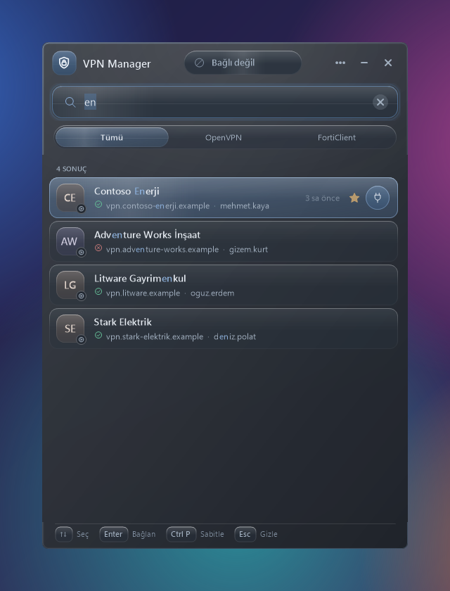
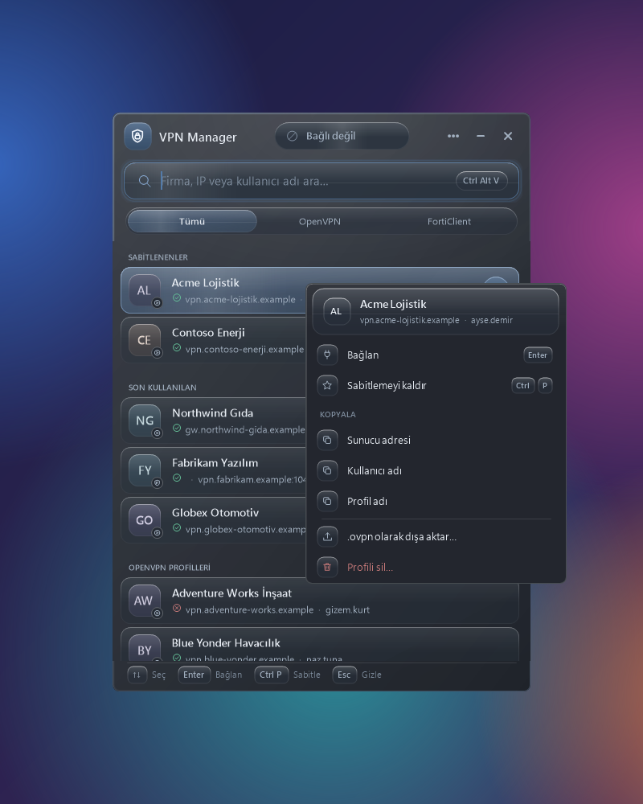
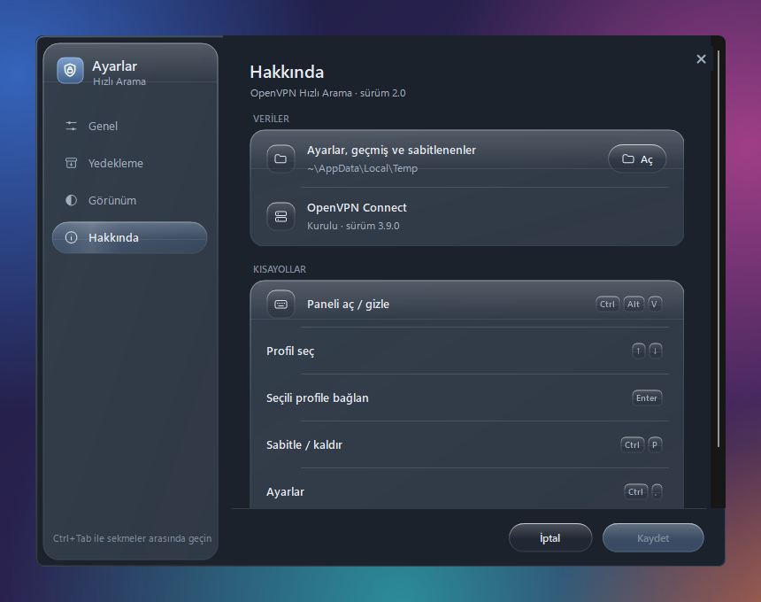

# VPN Manager — OpenVPN Hızlı Arama

OpenVPN Connect ve FortiClient VPN profillerinizi **tek bir cam (Liquid Glass) panelden** arayın, sabitleyin ve tek tıkla bağlanın.
Yüzlerce profil arasında firma adı, sunucu adresi, kullanıcı adı veya `.ovpn` dosya adıyla anında filtreler; Windows 10/11, tek `exe`, yönetici izni gerektirmez.

> **English summary:** A small Windows (WinForms/GDI+, .NET Framework 4.8) companion for OpenVPN Connect and FortiClient VPN. Instant fuzzy search over all saved profiles, one-click connect, pinning, live connection state, server reachability dots, backups, duplicate cleanup, connection history, light/dark/system themes. Install with one PowerShell line (below). Screenshots use fictional sample companies (`--demo` mode).

## Kurulum (tek komut)

PowerShell açın ve çalıştırın:

```powershell
irm https://raw.githubusercontent.com/bymrhan/vpn-manager/main/install.ps1 | iex
```

Betik son sürümün paketini [Releases](https://github.com/bymrhan/vpn-manager/releases) sayfasından indirir, **SHA-256 özetini doğrular**, `%LOCALAPPDATA%\Programs\OpenVPN Hizli Arama` klasörüne kurar (yönetici izni gerekmez), Başlat menüsü kısayolunu ekler ve ilk kurulum sihirbazını açar.

- Belirli sürüm: `$env:VPNM_VERSION = 'v2.0.0'` yazıp aynı komutu çalıştırın.
- Betiği çalıştırmadan önce okumak isterseniz: [`install.ps1`](install.ps1) (kısa ve yalnızca ASCII).
- Elle kurulum: [Releases](https://github.com/bymrhan/vpn-manager/releases) → `OpenVPN-Hizli-Arama-Kurulum.zip` → çıkarın → `Kur.cmd`.
- Kaldırma: `%LOCALAPPDATA%\Programs\OpenVPN Hizli Arama\Kaldir.cmd` (VPN uygulamalarındaki profillere dokunmaz).

**Gereksinimler:** Windows 10/11 (.NET Framework 4.8 Windows ile gelir) · OpenVPN Connect 3.x · FortiClient VPN 7.x (isteğe bağlı).

## Ekran görüntüleri

Görüntülerdeki tüm firmalar, sunucular ve kullanıcılar **uydurmadır** (`.example` alan adları). Kendi bilgisayarınızda göz atmak için bkz. [Demo modu](#demo-modu).

| Ana pencere (koyu) | Bağlı durum — "Dynamic Island" kapsülü |
|:--:|:--:|
|  |  |

| Arama ve eşleşme vurgusu | Açık tema |
|:--:|:--:|
|  |  |

| Açık tema, bağlı | Profil menüsü (sağ tık) |
|:--:|:--:|
|  |  |

| Ayarlar · Genel | Ayarlar · Yedekleme |
|:--:|:--:|
|  |  |

| Ayarlar · Görünüm | Ayarlar · Hakkında |
|:--:|:--:|
|  |  |

## Özellikler

### Arama ve liste
- **Anında filtre:** firma adı, sunucu adresi, kullanıcı adı veya kaynak dosya adı. Birden çok kelime desteklenir (`firma 10.0`): her kelime en az bir alanla eşleşmelidir. Türkçe karakter ve aksan farkı yok sayılır (`İklim` = `iklim`).
- **Kalite sıralaması:** sonuçlar eşleşme kalitesine göre dizilir, eşleşen harfler vurgulanır.
- **Gruplu görünüm:** arama boşken *Bağlı* · *Sabitlenenler* · *Son kullanılanlar* (5) · *Tüm profiller* (A–Z).
- **Sağlayıcı filtresi:** *Tümü / OpenVPN / FortiClient* kapsül kontrolü.
- **Kompakt satır:** baş harf avatarı (ada göre sabit renk), sağlayıcı rozeti, sunucu · kullanıcı, son bağlantı zamanı, sabitleme yıldızı, bağlan düğmesi.
- **Durum renkle değil, ikonla da** verilir: erişilebilir ✓, erişilemiyor ✕, kontrol ediliyor ◔; renk körü kullanıcılar için ayırt edilebilir.
- Akıcı kaydırma, koyu kaydırma çubuğu, satır yeniden dizilirken (sabitleme/filtre) kayan geçiş animasyonu.

### Bağlanma
- `Enter` veya karta tek tıklama: OpenVPN Connect'in `--connect-shortcut` seçeneğiyle hemen bağlanır.
- **Bağlantı kapsülü (Dynamic Island):** *Bağlı değil → Bağlanıyor → Kimlik doğrulanıyor → Bağlı (süre sayacı) → Kesiliyor → Hata* olmak üzere 6 durum; yay (spring) animasyonlarıyla genişler/daralır. Kapsüldeki düğmeyle bağlantı kesilir.
- Bağlanırken fiş düğmesi etrafında dönen ışık, doğrulanınca yeşil onay animasyonu; 45 sn içinde doğrulanamazsa kırmızı sallanma ve hata kapsülü.
- **FortiClient:** SSL VPN tüneli seçilir, FortiClient açılır ve *Connect*'e uygulama basar. Parola FortiClient'ta kayıtlıysa doğrudan bağlanır; değilse ilk seferde sorulur ve (isteğe bağlı) **Windows Kimlik Bilgileri**'nde saklanır. IPsec tünellerinde FortiClient yalnızca açılır.
- Bağlıyken satıra sağ tık veya ⋯ menüsünden **Bağlantıyı kes**.

### Pencere davranışı
- **Yan panel modu:** OpenVPN Connect açılınca çerçevesiz panel, OpenVPN'in görünür çerçevesine aynı yükseklikte yapışır; taşıma/boyut/küçültme/gizleme olaylarını WinEvent kancalarıyla anında izler. Sağda yer yoksa sola geçer; panel tarafı Ayarlar'dan seçilir.
- **Serbest mod:** üst şeritten sürükleyerek ayırın; OpenVPN kenarına bırakınca yeniden yapışır.
- **Genel kısayol `Ctrl+Alt+V`:** her yerden aç / gizle (Ayarlar'dan değiştirilebilir).
- Bildirim alanı simgesi: bağlantı durumuna göre değişir; sağ tık menüsünde *Hızlı bağlan* (sabitlenenler + son kullanılanlar), *Bağlantıyı kes*, *Şimdi yedekle*, *Ayarlar*, *Çıkış*.
- Tek örnek çalışır; Windows açılışında arka planda başlayıp OpenVPN açılınca görünür. `×` yalnızca gizler.

### Sabitleme, kopyalama
- `Ctrl+P`, satırdaki yıldız veya sağ tık ile sabitleme (`%APPDATA%\OpenVpnQuickSearch\pinned.txt`).
- Sağ tık: sunucu adresini, kullanıcı adını veya profil adını panoya kopyala.

### Yedekleme ve profil yönetimi (OpenVPN)
- **Şimdi yedekle:** tüm profiller tek `.zip` (her profil ayrı `.ovpn` + `manifest.json`). Kayıtlı parolalar yedeğe girmez.
- **Otomatik yedek:** Kapalı / Profil değişince / Günlük / Haftalık; saklanacak sayı ayarlanır, eskiler silinir.
- **Yedekten geri yükle** ve **`.ovpn` içe aktar** (çoklu seçim veya panele sürükle-bırak); aynı adlılar atlanır.
- **Yinelenen profil bulucu:** aynı sunucu+kullanıcı veya aynı ad; her grupta en son kullanılan korunur, silmeden önce onay.
- **Dışa aktar / sil** (onaylı, kalıcı) — sağ tık menüsünde.
- **Bağlantı geçmişi:** hangi profile, ne zaman, ne kadar bağlandınız; en çok kullanılan 5 profil; CSV dışa aktarma.
- **Sunucu erişim testi:** TCP bağlantı / UDP için ping, 8 eşzamanlı, 10 dakikada bir yenilenir; Ayarlar'dan kapatılabilir.

### Görünüm
- **Liquid Glass:** Windows 11'de DWM Acrylic arka plan; cam yüzeyler (renk tonu, doygunluk, parlama, yansıma, ince kenar çizgisi), yay tabanlı hareket sistemi, tek malzemeli menüler / ipuçları / diyaloglar / kaydırma çubukları.
- **3 tema:** Koyu (varsayılan) · Açık · Sistem. Tema ayarlarda anında önizlenir, kaydedilmezse geri alınır.
- **Windows 10 / Acrylic kapalıyken** opak malzemeyle düşer; görünüm bozulmaz.
- **Hareketi azalt:** Windows'ta animasyonlar kapalıysa tüm geçişler anında olur.
- **Yüksek DPI** desteği (sistem DPI ölçekleme), SVG-alt kümesi ikon kütüphanesi (`assets\`, exe'ye gömülü), kod ile çizilen uygulama/tepsi ikonları.
- Animasyonlar yalnızca panel veya OpenVPN ön plandayken çalışır; boşta işlemci kullanımı ≈ %0,2; panel gizliyken belleği Windows'a geri verir.

### Klavye
| Tuş | İşlev |
|---|---|
| `Ctrl+Alt+V` | Paneli aç / gizle (genel) |
| `↑` `↓` `PgUp` `PgDn` | Profil seç |
| `Enter` | Seçili profile bağlan |
| `Ctrl+P` | Sabitle / kaldır |
| `Ctrl+F` | Aramaya dön |
| `Ctrl+,` | Ayarlar |
| `Esc` | Aramayı temizle → pencereyi gizle |

## Güvenlik ve gizlilik
- OpenVPN profillerinden yalnızca **profil adı, sunucu, kullanıcı adı ve dosya adı** metadata'sı kullanılır; parola, özel anahtar ve sertifika içeriği saklanmaz, loglanmaz, ayarlara yazılmaz.
- FortiClient parolası yalnızca siz *"Bu bilgisayarda sakla"* derseniz **Windows Kimlik Bilgileri**'ne (`OpenVpnQuickSearch:forti:<tünel>`, kullanıcıya bağlı şifreli) yazılır; FortiClient'ın kendi kayıtlı parolaları okunmaz.
- Ağ erişimi yalnızca sunucu erişim testi içindir (TCP/ping). Telemetri yoktur.
- **Yedekler `.ovpn` içindeki özel anahtarları içerir**; güvenli yerde tutun.
- Bu repo ve sürüm paketleri **hiçbir profil, anahtar veya firma verisi içermez** (`.gitignore` `*.ovpn`, `profiller/`, `*.zip` dosyalarını dışarıda tutar).
- Uygulama şu an imzasız: Windows SmartScreen "bilinmeyen yayıncı" uyarısı gösterebilir. Dilerseniz [`install.ps1`](install.ps1) ve kaynak kodu inceleyip kendiniz derleyebilirsiniz.

## Bilinen sınırlar
- FortiClient'ta otomatik *Connect*, FortiClient 7.4 İngilizce arayüzüyle denendi; arayüz dili/sürümü değişirse düğme bulunamayabilir (uygulama FortiClient'ı açıp "Connect'e basın" der).
- OpenVPN Connect komut satırı yeniden adlandırmayı desteklemediği için profil yeniden adlandırma yoktur.
- Yedekleme, dışa aktarma, silme ve yinelenen bulucu yalnızca OpenVPN profilleri içindir.
- Cam efekti Windows 11 22H2+ üzerinde DWM Acrylic ile en iyi görünür.

## Demo modu
Gerçek profilleriniz yerine uydurma örnek firmalarla arayüzü denemek (ekran görüntüsü almak) için:

```powershell
& "$env:LOCALAPPDATA\Programs\OpenVPN Hizli Arama\OpenVPN-Hizli-Arama.exe" --demo --instance=demo --settings="$env:TEMP\vpnm-demo.json"
```

Ek anahtarlar: `--demo-connected=Acme` (örnek profili bağlı göster), `--demo-search=en`, `--demo-settings=0..3` (Ayarlar sayfası), `--scale=1.5`. Demo modunda OpenVPN Connect / FortiClient'a, sabitleme dosyasına ve ayarlara **dokunulmaz**; hiçbir bağlantı başlatılmaz.

## Geliştirme

Yalnızca Windows'un kendi C# derleyicisi (`csc.exe`, .NET Framework 4.x) gerekir; harici paket yoktur.

```powershell
# derle + 20 otomatik test + kurulum paketi (outputs\ klasörüne)
powershell -NoProfile -ExecutionPolicy Bypass -File build.ps1 -NoProfiles

# yalnızca testler
powershell -NoProfile -ExecutionPolicy Bypass -File tests\run-tests.ps1
```

`-NoProfiles` bu bilgisayarın profillerini pakete **koymaz** (dağıtım için bunu kullanın). Profilli paket yalnızca kendi cihazlarınıza taşıma içindir ve asla paylaşılmamalıdır.

| Yol | İçerik |
|---|---|
| `OpenVpnQuickSearch.cs` | Ana pencere, profil deposu, bağlanma akışı, `Program.Main` |
| `modules\Glass.cs` | Cam malzeme, Acrylic/DWM, yay animasyonları, alfa-doğru metin çizimi |
| `modules\GlassUi.cs`, `GlassList.cs`, `GlassDialog.cs` | Arama kutusu, kapsül kontrol, bağlantı adası, profil listesi, diyalog, toast |
| `modules\MenuKit.cs`, `Assets.cs`, `assets\*.svg` | Menüler, SVG ikon kütüphanesi |
| `modules\SettingsWindow.cs`, `Settings.cs`, `SetupWizard.cs` | Ayarlar, temalar, ilk kurulum sihirbazı |
| `modules\Connection.cs`, `FortiClient.cs`, `Reachability.cs` | Bağlantı izleme / geçmiş, FortiClient entegrasyonu, erişim testi |
| `modules\BackupService.cs`, `ImportService.cs`, `Duplicates.cs` | Yedek, içe/dışa aktarma, yinelenen profiller |
| `modules\Demo.cs` | `--demo` örnek verisi |
| `paket\` | Kurulum paketi şablonları (`kur.ps1`, `kaldir.ps1`, `BENIOKU.txt`, kullanım) |
| `install.ps1` | Uzaktan tek komut kurulum |
| `tests\` | Otomatik testler; `tests\manual\` gerçek FortiClient penceresine karşı elle denemeler |

Tek satırla derleme:

```powershell
& "$env:WINDIR\Microsoft.NET\Framework64\v4.0.30319\csc.exe" /nologo /target:winexe /optimize+ /codepage:65001 /out:OpenVPN-Hizli-Arama.exe /r:System.Web.Extensions.dll /r:System.Windows.Forms.dll /r:System.Drawing.dll /r:System.IO.Compression.dll /r:System.IO.Compression.FileSystem.dll /r:Accessibility.dll /win32icon:app.ico /resource:app.ico,app.ico (Get-ChildItem assets\*.svg | % { "/resource:$($_.FullName),$($_.Name)" }) OpenVpnQuickSearch.cs (Get-ChildItem modules\*.cs).FullName
```

Kaynak dosyalar UTF-8 **BOM'lu** ve CRLF'dir (Türkçe metin için `csc` ve Windows PowerShell 5.1 BOM ister); `.gitattributes` bunu korur.

## Sürüm
**2.0.0** — Liquid Glass yeniden tasarımı: cam malzeme sistemi, bağlantı kapsülü, yeni liste/menü/ayarlar, SVG ikon kütüphanesi, FortiClient entegrasyonu, uzaktan kurulum.
