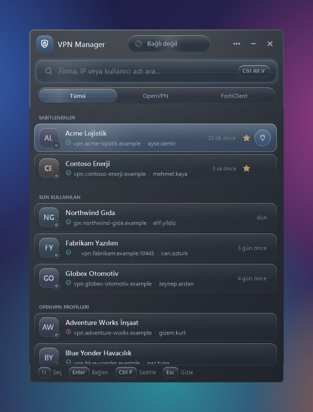
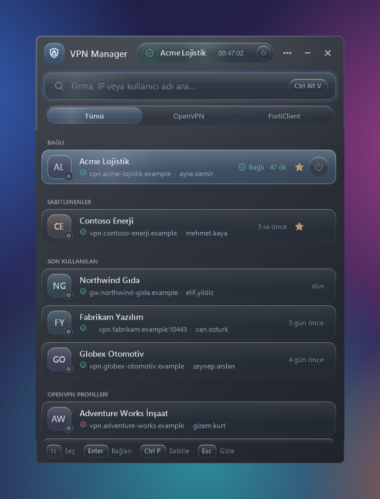
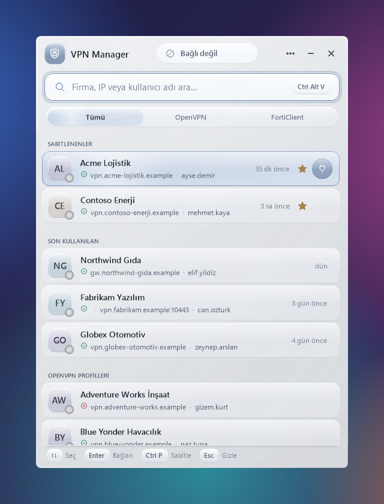
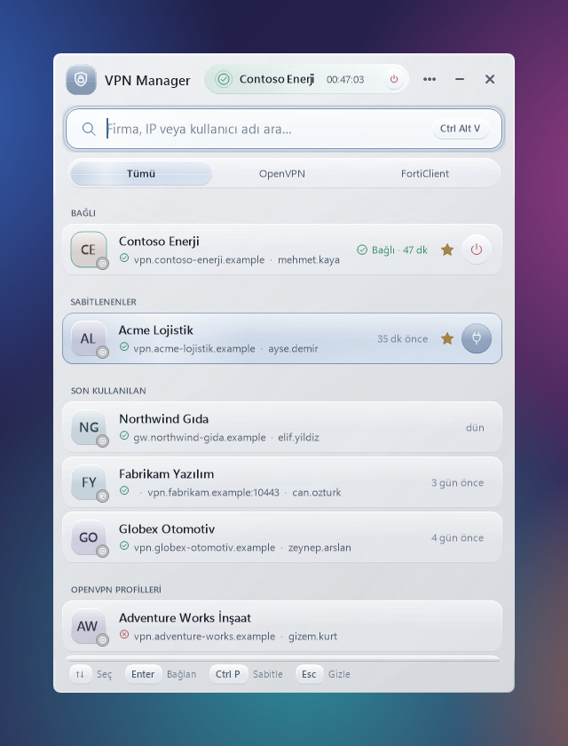
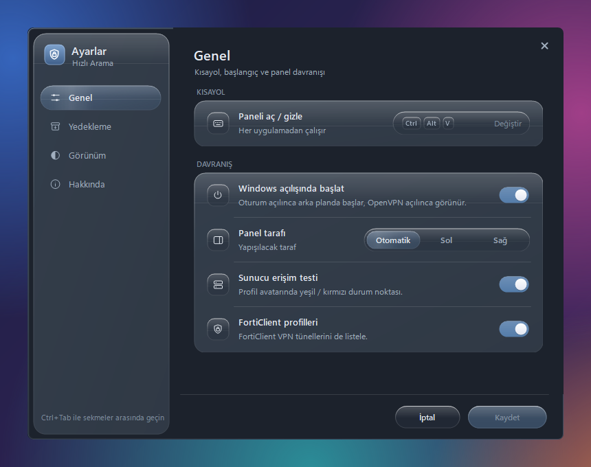
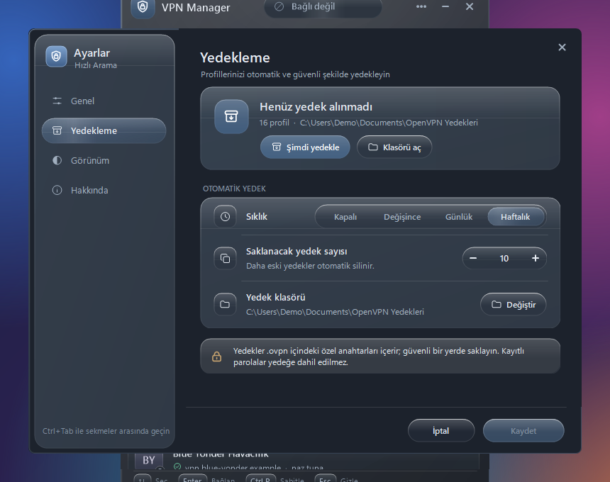
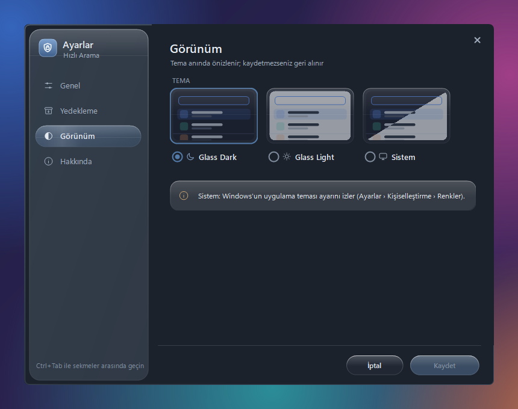

# VPN Manager — OpenVPN Hızlı Arama

OpenVPN Connect, FortiClient VPN, Sophos Connect ve WatchGuard Mobile VPN with SSL profillerinizi **tek bir cam (Liquid Glass) panelden** arayın, sabitleyin ve tek tıkla bağlanın.
Yüzlerce profil arasında firma adı, sunucu adresi, kullanıcı adı veya `.ovpn` dosya adıyla anında filtreler; Windows 10/11, tek `exe`, yönetici izni gerektirmez.

> **English summary:** A small Windows (WinForms/GDI+, .NET Framework 4.8) companion for OpenVPN Connect, FortiClient VPN, Sophos Connect and WatchGuard Mobile VPN with SSL. Instant fuzzy search over all saved profiles, one-click connect/disconnect, pinning, a "Sık kullanılanlar" (frequently used) group under the recent profiles (at least 3 connections in the last 60 days, up to 5, not repeating rows shown above, hidden when empty, toggle in Ayarlar > Genel), live connection state, server reachability dots, backups, duplicate cleanup, connection history, light/dark/system themes, a choice of where the app lives ("Uygulama nerede görünsün": tray icon only (default), tray icon plus a taskbar button while the window is shown, or a taskbar button for as long as the app runs with no tray icon, where hiding minimizes to the button and closing the window exits; applied live, the 2.1.0 "Görev çubuğunda göster" toggle migrates). Connecting runs in the background (client windows are not brought to the front; they appear only when you must act). Optional self-update from GitHub Releases (ask / automatic / off, SHA-256 verified, rollback). Own log (`%APPDATA%\OpenVpnQuickSearch\logs`) and a consent-based error report: after a crash the app offers to send a sanitized report (no passwords, usernames, profile/customer names, hosts, IPs, e-mail, machine name or user paths). Builds without a token open it as a pre-filled GitHub issue page in the user's browser (the report travels to GitHub inside that page's address but is published only when the user presses Submit). Release builds may embed a GitHub token (recommended: a classic `public_repo` token of a separate bot account, which can only open issues and comments here as a stranger; anyone can extract it from the exe); the app then creates the public issue itself after the user agreed, or without asking in the automatic mode, which needs a one-time confirmed warning (at most 3 a day per install). Local log files are not sanitized; only reports are. Sophos and WatchGuard get their filter tab as soon as the client is installed and enabled, even with no connection yet (the empty tab says how to add one). The app is unsigned. The Sophos list/state output format was verified only against an empty profile list, and WatchGuard (single connection, driven through its dialog) was not exercised against a live tunnel. Install with one PowerShell line (below). Screenshots use fictional sample companies (`--demo` mode).

## Kurulum (tek komut)

PowerShell açın ve çalıştırın:

```powershell
irm https://raw.githubusercontent.com/bymrhan/vpn-manager/main/install.ps1 | iex
```

Betik son sürümün paketini [Releases](https://github.com/bymrhan/vpn-manager/releases) sayfasından indirir, **SHA-256 özetini doğrular**, `%LOCALAPPDATA%\Programs\OpenVPN Hizli Arama` klasörüne kurar (yönetici izni gerekmez), Başlat menüsü kısayolunu ekler ve ilk kurulum sihirbazını açar. Uygulama zaten kuruluysa sihirbaz açılmaz, kurulu kopya sessizce güncellenir (aşağıya bakın).

- Belirli sürüm: `$env:VPNM_VERSION = 'v2.0.0'` yazıp aynı komutu çalıştırın.
- Betiği çalıştırmadan önce okumak isterseniz: [`install.ps1`](install.ps1) (kısa ve yalnızca ASCII).
- Elle kurulum: [Releases](https://github.com/bymrhan/vpn-manager/releases) → `OpenVPN-Hizli-Arama-Kurulum.zip` → çıkarın → `Kur.cmd`.
- Kaldırma: `%LOCALAPPDATA%\Programs\OpenVPN Hizli Arama\Kaldir.cmd` (VPN uygulamalarındaki profillere dokunmaz).

**Gereksinimler:** Windows 10/11 (.NET Framework 4.8 Windows ile gelir) · OpenVPN Connect 3.x · FortiClient VPN 7.x, Sophos Connect ve WatchGuard Mobile VPN with SSL (hepsi isteğe bağlı; yalnızca kurulu olanlar listelenir).

Kurulu kopya kendini de güncelleyebilir; bkz. [Güncelleme](#güncelleme).

**Eski sürümden güncelleme:** 2.0.0 kendini güncelleyemez; 2.0.0 kullanıcıları yukarıdaki komutu **bir kez** yeniden çalıştırır. Betik mevcut kurulumu bulur, çalışan uygulamayı kapatır, program dosyalarını yerinde günceller ve uygulamayı arka planda yeniden başlatır; ayarlar, sabitlenenler, geçmiş ve profiller korunur, sihirbaz açılmaz. Sonraki güncellemeler [Güncelleme](#güncelleme) ayarlarına göre otomatik gelir.

## Ekran görüntüleri

Görüntülerdeki tüm firmalar, sunucular ve kullanıcılar **uydurmadır** (`.example` alan adları). Kendi bilgisayarınızda göz atmak için bkz. [Demo modu](#demo-modu).

| Ana pencere (koyu) | Bağlı durum — "Dynamic Island" kapsülü |
|:--:|:--:|
|  |  |

| Arama ve eşleşme vurgusu | Açık tema |
|:--:|:--:|
|  |  |

| Açık tema, bağlı | Profil menüsü (sağ tık) |
|:--:|:--:|
|  |  |

| Ayarlar · Genel | Ayarlar · Yedekleme |
|:--:|:--:|
|  |  |

| Ayarlar · Görünüm | Ayarlar · Hakkında |
|:--:|:--:|
|  |  |

## Desteklenen istemciler

| | OpenVPN Connect | FortiClient VPN | Sophos Connect | WatchGuard Mobile VPN with SSL |
|---|---|---|---|---|
| Profil listeleme | OpenVPN Connect'in profil deposundan | FortiClient'taki SSL VPN ve IPsec tünelleri | `sccli list` ile | Kayıt defterindeki sunucu girdileri |
| Bağlan | `--connect-shortcut` ile | SSL VPN: tünel seçilir, *Connect*'e uygulama basar; IPsec: yalnızca açılır | `sccli enable` | İstemcinin giriş penceresi arka planda doldurulur ve *Connect*'e basılır |
| Bağlantıyı kes | Evet | Evet | `sccli disable` | Evet (istemcinin menü komutu; olmazsa istemci kapatılır) |
| Durum izleme | Evet | Evet | `sccli get` ve Sophos ağ bağdaştırıcısı | İstemci günlüğü ve TAP bağdaştırıcısı |
| Kayıtlı parola (uygulamada) | Yok; OpenVPN Connect kendi parolasını tutar | Windows Kimlik Bilgileri (`OpenVpnQuickSearch:forti:<tünel>`) | Windows Kimlik Bilgileri (`OpenVpnQuickSearch:sophos:<bağlantı>`) | Windows Kimlik Bilgileri (`OpenVpnQuickSearch:watchguard:<sunucu>`) |
| Yedek, dışa aktarma, silme, yinelenenler | Evet | Hayır | Hayır | Hayır |

Her istemci yalnızca bilgisayarınızda kuruluysa ve Ayarlar'da açıksa listelenir (bkz. [Ayarlar](#ayarlar)).

**Bilinen sınırlar (istemciye göre)**
- **Sophos Connect:** `sccli list` / `get` çıktı biçimi bu geliştirme bilgisayarında yalnızca **boş profil listesiyle** doğrulandı (`Connections:` / `None`). Gerçek bir profil varken liste, bağlantı durumu ve sunucu adresi ayrıştırması denenmedi; biçim beklenenden farklıysa liste boş veya durum "bağlı değil" görünebilir. `sccli enable` parolayı kısa süre komut satırı argümanı olarak taşır.
- **WatchGuard Mobile VPN with SSL:** istemcinin komut satırında bağlan/kes anahtarı olmadığından uygulama onun penceresini sürer (Win32 mesajları). Tek seferde **tek bağlantı** vardır. Bağlan/kes akışı **canlı bir tünele karşı denenmedi**; ilk gerçek kullanımı izleyin. Parola uygulamada kayıtlı değilse ve istemci de hatırlamıyorsa pencere size gösterilir. Ayrıntılar: [`docs/providers/watchguard-ssl.md`](docs/providers/watchguard-ssl.md).
- **FortiClient:** bkz. [Bilinen sınırlar](#bilinen-sınırlar).

## Özellikler

### Arama ve liste
- **Anında filtre:** firma adı, sunucu adresi, kullanıcı adı veya kaynak dosya adı. Birden çok kelime desteklenir (`firma 10.0`): her kelime en az bir alanla eşleşmelidir. Türkçe karakter ve aksan farkı yok sayılır (`İklim` = `iklim`).
- **Kalite sıralaması:** sonuçlar eşleşme kalitesine göre dizilir, eşleşen harfler vurgulanır.
- **Gruplu görünüm:** arama boşken *Bağlı* · *Sabitlenenler* · *Son kullanılanlar* (5) · *Sık kullanılanlar* (en fazla 5) · *Tüm profiller* (A–Z).
- **Sık kullanılanlar:** bağlantı geçmişine (`history.csv`) göre son 60 günde en az 3 kez bağlanılan profiller, bağlantı sayısına göre (eşitlikte en son kullanılan önce), en fazla 5 tane. 3 saniyeden kısa oturumlar ve aynı saniyede başlayan yinelenen kayıtlar sayılmaz. Üstteki gruplarda (bağlı, sabitlenen, son kullanılan) görünen profil burada tekrar listelenmez; geriye profil kalmazsa grup gizlenir. Seçili sağlayıcı filtresine uyar; arama yazılınca liste her zamanki gibi sonuçlara göre sıralanır. Ayarlar > Genel > *Sık kullanılanları göster* ile kapatılabilir.
- **Sağlayıcı filtresi:** *Tümü / OpenVPN / FortiClient / Sophos / WatchGuard* kapsül kontrolü; Sophos ve WatchGuard bölümleri ilgili istemci kuruluysa ve Ayarlar'da açıksa görünür; hiç bağlantı yoksa da sekme çıkar ve liste nasıl ekleneceğini söyler (Sophos: *.pro* veya *.ovpn* dosyasını Sophos Connect'e ekleyin; WatchGuard: istemcide kayıtlı sunucu yok). `Ctrl+1` … `Ctrl+5` bölümü seçer.
- **Gruplar:** *OpenVPN profilleri*, *FortiClient VPN*, *Sophos Connect*, *WatchGuard SSL VPN*.
- **Kompakt satır:** baş harf avatarı (ada göre sabit renk), sağlayıcı rozeti (Sophos ve WatchGuard için ayrı simgeler), sunucu · kullanıcı, son bağlantı zamanı, sabitleme yıldızı, bağlan düğmesi.
- **Durum renkle değil, ikonla da** verilir: erişilebilir ✓, erişilemiyor ✕, kontrol ediliyor ◔; renk körü kullanıcılar için ayırt edilebilir.
- Akıcı kaydırma, koyu kaydırma çubuğu, satır yeniden dizilirken (sabitleme/filtre) kayan geçiş animasyonu.

### Bağlanma
- `Enter` veya karta tek tıklama: OpenVPN Connect'in `--connect-shortcut` seçeneğiyle hemen bağlanır.
- **Bağlantı kapsülü (Dynamic Island):** *Bağlı değil → Bağlanıyor → Kimlik doğrulanıyor → Bağlı (süre sayacı) → Kesiliyor → Hata* olmak üzere 6 durum; yay (spring) animasyonlarıyla genişler/daralır. Kapsüldeki düğmeyle bağlantı kesilir.
- Bağlanırken fiş düğmesi etrafında dönen ışık, doğrulanınca yeşil onay animasyonu; 45 sn içinde doğrulanamazsa kırmızı sallanma ve hata kapsülü.
- **FortiClient:** SSL VPN tüneli seçilir ve *Connect*'e uygulama basar. Parola FortiClient'ta kayıtlıysa doğrudan bağlanır; değilse ilk seferde sorulur ve (isteğe bağlı) **Windows Kimlik Bilgileri**'nde saklanır. IPsec tünellerinde FortiClient yalnızca açılır.
- **Sophos Connect ve WatchGuard:** kayıtlı parola yoksa ilk bağlanışta kullanıcı adı/parola sorulur ("Bu bilgisayarda sakla" ile saklanır; vazgeçerseniz parolasız denenir). Sağ tık menüsünde *Parolayı kaydet… / Kayıtlı parolayı değiştir… / Kayıtlı parolayı sil* bulunur. Bağlantı, durum yoklamasıyla doğrulanır; 120 sn içinde doğrulanamazsa hata gösterilir.
- Bağlıyken satıra sağ tık veya ⋯ menüsünden **Bağlantıyı kes**; bildirim alanı menüsünde de her istemci için kesme öğesi vardır.

### Arka planda çalışma
Bağlanma ve kesme sırasında istemci pencereleri **öne getirilmez**; çalıştığınız uygulama odağını korur.
- **OpenVPN Connect:** komutla açılan pencere, önceden açık değilse odak almadan küçültülür. Bağlantı ~9 sn içinde kurulmazsa (kayıtlı parola yok, statik / MFA sorusu) uygulamanın küçülttüğü pencere geri açılıp öne getirilir; sizin küçülttüğünüz pencereye dokunulmaz.
- **FortiClient:** arayüzü okunabilsin diye pencere ekranın dışına park edilir, iş bitince kapatılır.
- **WatchGuard:** giriş ve durum pencereleri arka planda (ekran dışında) sürülür.
- **Sophos Connect:** `sccli` komut satırıyla çalışır, kendi penceresi açılmaz.
- **Sizin açtığınız pencereye dokunulmaz:** o anda ekranda açık olan istemci penceresi taşınmaz, kapatılmaz, doldurulmaz.
- İstemci penceresi **yalnızca sizin işlem yapmanız gerekiyorsa** görünür (parola, token/SAML, hata gibi).

### Pencere davranışı
- **Yan panel modu:** OpenVPN Connect açılınca çerçevesiz panel, OpenVPN'in görünür çerçevesine aynı yükseklikte yapışır; taşıma/boyut/küçültme/gizleme olaylarını WinEvent kancalarıyla anında izler. Sağda yer yoksa sola geçer; panel tarafı Ayarlar'dan seçilir.
- **Serbest mod:** üst şeritten sürükleyerek ayırın; OpenVPN kenarına bırakınca yeniden yapışır.
- **Genel kısayol `Ctrl+Alt+V`:** her yerden aç / gizle (Ayarlar'dan değiştirilebilir).
- Bildirim alanı simgesi: bağlantı durumuna göre değişir; sağ tık menüsünde *Hızlı bağlan* (sabitlenenler + son kullanılanlar), *Bağlantıyı kes*, *Şimdi yedekle*, *Ayarlar*, *Çıkış*.
- Tek örnek çalışır; Windows açılışında arka planda başlayıp OpenVPN açılınca görünür. `×` yalnızca gizler.
- **Uygulama nerede görünsün** (Ayarlar > Genel, üç seçenek; kaydedince yeniden başlatmadan uygulanır):
  - *Tepsi* (varsayılan): simge bildirim alanında (tepside); pencere gizlenince görev çubuğunda görünmez.
  - *Tepsi + düğme*: tepsi simgesi, ayrıca pencere açıkken görev çubuğunda (uygulama simgesi ve "OpenVPN Hızlı Arama" başlığıyla) ve Alt+Tab'da bir düğme. Pencere tepsiye gizlenince düğme de kaybolur. 2.1.0'daki *Görev çubuğunda göster* açıksa bu seçeneğe taşınır.
  - *Görev çubuğu*: tepsi simgesi gizlenir; düğme uygulama açık olduğu sürece görev çubuğunda durur. Gizlemek (`Esc`, `×`, kısayol, bağlandıktan sonra ve OpenVPN penceresi kapanınca otomatik gizleme) pencereyi düğmeye küçültür; düğmeye tıklamak veya kısayol geri getirir. `--background` ile (Windows açılışı) küçültülmüş başlar. Pencereyi kapatmak (Alt+F4, görev çubuğunda *Pencereyi kapat*) ya da ⋯ menüsündeki *Çıkış* uygulamadan çıkar. Diğer iki seçenekte Alt+F4 yalnızca gizler; Windows oturumu kapanırken uygulama her seçenekte kapanır.

### Sabitleme, kopyalama
- `Ctrl+P`, satırdaki yıldız veya sağ tık ile sabitleme (`%APPDATA%\OpenVpnQuickSearch\pinned.txt`).
- Sağ tık: sunucu adresini, kullanıcı adını veya profil adını panoya kopyala.

### Yedekleme ve profil yönetimi (OpenVPN)
- **Şimdi yedekle:** tüm profiller tek `.zip` (her profil ayrı `.ovpn` + `manifest.json`). Kayıtlı parolalar yedeğe girmez.
- **Otomatik yedek:** Kapalı / Profil değişince / Günlük / Haftalık; saklanacak sayı ayarlanır, eskiler silinir.
- **Yedekten geri yükle** ve **`.ovpn` içe aktar** (çoklu seçim veya panele sürükle-bırak); aynı adlılar atlanır.
- **Yinelenen profil bulucu:** aynı sunucu+kullanıcı veya aynı ad; her grupta en son kullanılan korunur, silmeden önce onay.
- **Dışa aktar / sil** (onaylı, kalıcı) — sağ tık menüsünde.
- **Bağlantı geçmişi:** hangi profile, ne zaman, ne kadar bağlandınız; en çok kullanılan 5 profil; CSV dışa aktarma.
- **Sunucu erişim testi:** TCP bağlantı / UDP için ping, 8 eşzamanlı, 10 dakikada bir yenilenir; Ayarlar'dan kapatılabilir.

### Görünüm
- **Liquid Glass:** Windows 11'de DWM Acrylic arka plan; cam yüzeyler (renk tonu, doygunluk, parlama, yansıma, ince kenar çizgisi), yay tabanlı hareket sistemi, tek malzemeli menüler / ipuçları / diyaloglar / kaydırma çubukları.
- **3 tema:** Koyu (varsayılan) · Açık · Sistem. Tema ayarlarda anında önizlenir, kaydedilmezse geri alınır.
- **Windows 10 / Acrylic kapalıyken** opak malzemeyle düşer; görünüm bozulmaz.
- **Hareketi azalt:** Windows'ta animasyonlar kapalıysa tüm geçişler anında olur.
- **Yüksek DPI** desteği (sistem DPI ölçekleme), SVG-alt kümesi ikon kütüphanesi (`assets\`, exe'ye gömülü), kod ile çizilen uygulama/tepsi ikonları.
- Animasyonlar yalnızca panel veya OpenVPN ön plandayken çalışır; boşta işlemci kullanımı ≈ %0,2; panel gizliyken belleği Windows'a geri verir.

### Klavye
| Tuş | İşlev |
|---|---|
| `Ctrl+Alt+V` | Paneli aç / gizle (genel) |
| `Ctrl+1` … `Ctrl+5` | Sağlayıcı bölümünü seç (Tümü, OpenVPN, FortiClient, Sophos, WatchGuard; görünen bölümlerin sırasıyla) |
| `↑` `↓` `PgUp` `PgDn` | Profil seç |
| `Enter` | Seçili profile bağlan |
| `Ctrl+P` | Sabitle / kaldır |
| `Ctrl+F` | Aramaya dön |
| `Ctrl+,` | Ayarlar |
| `Esc` | Aramayı temizle → pencereyi gizle (*Görev çubuğu* seçeneğinde küçült) |

## Ayarlar
`⋯ > Ayarlar…` veya `Ctrl+,`; dört sayfa: *Genel*, *Yedekleme*, *Görünüm*, *Hakkında*. Dosya: `%APPDATA%\OpenVpnQuickSearch\settings.json`.
- **Genel:** kısayol tuşu, Windows açılışında başlat, uygulama nerede görünsün (*Tepsi* / *Tepsi + düğme* / *Görev çubuğu*), panel tarafı, sunucu erişim testi, *Sık kullanılanları göster* (varsayılan açık; kaydedince yeniden başlatmadan uygulanır) ve her istemci için bir anahtar: *FortiClient profilleri*, *Sophos Connect profilleri*, *WatchGuard profilleri*. Sophos ve WatchGuard anahtarları yalnızca o istemci **algılanırsa** görünür. Bir anahtarı kapatmak o istemcinin satırlarını listeden kaldırır ve durumunu sıfırlar; anahtarlar yeniden başlatmada korunur.
- **Yedekleme** ve **Görünüm:** yedek sıklığı / sayısı / klasörü; tema.
- **Hakkında > Güncelleme:** bkz. aşağıdaki [Güncelleme](#güncelleme).
- **Hakkında > Tanılama:** *Hata kaydı tut*, *Çökmeden sonra rapor öner*, *Günlük klasörünü aç*, *Son hatayı bildir*; bkz. [Hata raporları ve günlükler](#hata-raporları-ve-günlükler).

## Güncelleme
Uygulama, bu deponun [Releases](https://github.com/bymrhan/vpn-manager/releases) sayfasındaki son sürümü denetler. Ayarlar > Hakkında > **Güncelleme** bloğu:
- **Güncellemeler:** *Sor* (varsayılan; yeni sürüm bildirimi çıkar: *Şimdi güncelle* / *Sonra* / *Bu sürümü atla* / *Sürüm notları*), *Otomatik* (indirir, doğrular ve boştayken sessizce kurar) veya *Kapalı* (otomatik denetim yok).
- **Denetleme sıklığı:** *Açılışta* / *Günlük* (varsayılan) / *Haftalık*. İstek yalnızca `api.github.com` sürüm bilgisini alır; profil bilgisi veya kullanıcı verisi gönderilmez.
- **Şimdi denetle** her kipte çalışır; **Bu sürümü atla** o sürümü otomatik denetimlerde gizler. Sürüm notları düğmesi sürüm sayfasını açar.
- **Boştayken kurulum (Otomatik):** panel gizli/küçültülmüş ya da 2 dakikadır giriş yok; bağlanma/kesme sürmüyor; uygulamanın başka penceresi açık değil. Bağlı bir VPN kurulumu engellemez. Uygulama arka planda yeniden başlar.
- **Doğrulama:** paket `OpenVPN-Hizli-Arama-Kurulum.zip` ve yanındaki `.sha256` dosyasıyla indirilir; özet uyuşmazsa veya dosya yoksa **hiçbir şey kurulmaz**. Kurulum başarısız olursa değişen dosyalar yedekten geri alınır, eski sürüm yeniden açılır ve aynı sürüm 24 saat boyunca otomatik denenmez (`guncelleme-basarisiz.txt`). Günlük: kurulum klasöründe `guncelleme.log`.
- **Yalnızca kurulu kopya** (`%LOCALAPPDATA%\Programs\OpenVPN Hizli Arama`) kendini günceller; başka yerdeki (taşınabilir) kopya sadece bildirim gösterir ve sürüm sayfasını açar. Ayarlar, sabitlenenler, geçmiş ve profiller korunur.
- Demo modunda güncelleme denetlenmez.
- **Sınır:** `.sha256` dosyası zip ile **aynı GitHub sürümünden** gelir; bozuk/yarım indirmeye ve sahte yansıya karşı korur, ele geçirilmiş bir yayıncı hesabına karşı korumaz (uygulama imzasızdır).

Sürüm yayınlama adımları için bkz. [`docs/RELEASING.md`](docs/RELEASING.md) (`build.ps1 -NoProfiles` zip'in yanına `.sha256` yazar; ikisi de sürüme yüklenir).

## Tanılama
- **Uygulama günlüğü** `%APPDATA%\OpenVpnQuickSearch\logs\app-YYYYMMDD.log`: bkz. [Hata raporları ve günlükler](#hata-raporları-ve-günlükler). FortiClient otomatik bağlanma adımları da buraya `forti` etiketiyle yazılır (eski `forti.log` artık yazılmaz; kalan dosyayı silebilirsiniz).
- `%APPDATA%\OpenVpnQuickSearch\history.csv`: bağlantı geçmişi; `pinned.txt`: sabitlenenler.
- Güncelleme kurulumu için kurulum klasöründeki `guncelleme.log` (yukarıya bakın).

## Hata raporları ve günlükler
Uygulama kendi günlüğünü tutar ve beklenmedik bir hatadan sonra **sizin onayınızla** GitHub'da bir hata kaydı (issue) açmanızı önerir. Kayıtlar bu deponun [Issues](https://github.com/bymrhan/vpn-manager/issues?q=label%3Ahata) bölümünde `hata` etiketiyle toplanır; düzeltmeler oradan yapılır.

**Ne kaydedilir, nereye**
- `%APPDATA%\OpenVpnQuickSearch\logs\app-YYYYMMDD.log` (UTF-8): açılış/kapanış (sürüm, Windows, .NET, ekran ölçeği, hangi VPN istemcilerinin kurulu olduğu), her sağlayıcı için bağlan/kes istekleri ve sonuçları (**yalnızca sağlayıcı türü ve sonuç**; profil adı, sunucu, kullanıcı adı yazılmaz), güncelleme denetimleri, istemci yoklama hataları (10 dakikada en fazla bir satır) ve hatalar (yığın izi, mutlak yol olmadan). Parola hiçbir zaman yazılmaz.
- Satır biçimi: `zaman düzey kaynak ileti` (ör. `2026-11-25 14:03:11.123 INFO  forti connect outcome: Pressed`). En fazla 5 dosya × ~512 KB tutulur, eskiler silinir. Yazma arka planda yapılır; arayüzü bekletmez.
- Yakalanmamış bir hata olursa aynı klasöre temizlenmiş bir kayıt (`crash-<zaman>.txt`) ve bir sonraki açılış için işaret yazılır; bağlanma sırasında yakalanan hatalar `error-<zaman>.txt` olarak tutulur (her türden en fazla 5).
- **Günlük dosyaları (`app-*.log`) temizlenmez**; temizleme yalnızca raporlara uygulanır. Bu dosyaları başkasıyla paylaşmadan önce okuyun.
- Ayarlar > Hakkında > *Hata kaydı tut* kapatılırsa günlük ve hata kayıtları yazılmaz. Demo modunda (`--demo`) hiçbir şey yazılmaz ve tarayıcı açılmaz.

**Rapor ne içerir / ne içermez**
- İçerir: uygulama sürümü, Windows ve .NET sürümü, ekran ölçeği, VPN istemcilerinin kurulu olup olmadığı (var/yok), hatanın türü ve kod konumları (sınıf ve yöntem adları; sürüm derlemeleri PDB içermediği için dosya adı ve satır numarası yoktur), son 60 günlük satırı ve 8 karakterlik bir **parmak izi** (hata türü + ilk 3 yöntem adı; satır numarası ve yol içermez, sürümler arasında aynı kalır).
- İçermez: parolalar, belirteçler ve anahtarlar (PEM / `.ovpn` anahtar blokları), kullanıcı adları, profil ve müşteri adları, `.ovpn` dosya adları, sunucu adları, IP (v4/v6) ve e-posta adresleri, makine adı, Windows kullanıcı adı ve kişisel klasör yolları. Bilinen değerler (yüklü profiller, kayıtlı kimlik bilgilerinin kullanıcı adları, Windows kullanıcı/makine adı) `<profil-1>`, `<sunucu-2>`, `<kullanici>`, `<makine>`, `~` gibi yer tutuculara çevrilir; Türkçe büyük/küçük harf farkları (İ/ı, Ş/ş …) ve fazla boşluklar da eşleşir. Geri kalanlar kalıplarla (IP, `ad.uzantı` biçimli sunucu adı, `kullanıcı@sunucu`, `ALAN\kullanıcı`, `password=`, `-p <değer>`, `-u kullanıcı:parola`, `Authorization`, çerez, uzun base64/hex, müşteri klasörü yolları) yakalanır; 1000 karakterden uzun satırlar kısaltılır. Temizleme kalıp tabanlıdır: tanınmayan serbest metin kalabilir, bu yüzden göndermeden önce okuyun. Hata iletilerindeki tırnak içi metinler (yollar, adlar) tümüyle çıkarılır.

**Nasıl bildirilir (anahtarsız derleme: tarayıcı)**
1. Çökmeden sonraki açılışta: *"Önceki oturum beklenmedik şekilde kapandı. Hata raporunu GitHub'a göndermek ister misiniz?"* → **Raporu GitHub'a gönder** / **Raporu göster** / **Sonra** (sonraki açılışta yeniden sorar, en fazla 3 kez) / **Bir daha sorma**. İstediğiniz zaman: Ayarlar > Hakkında > **Son hatayı bildir**.
2. Uygulama önce aynı parmak izli bir kayıt var mı diye GitHub'ın herkese açık arama API'sine **salt okunur** bir istek yapar (yalnızca 8 karakterlik parmak izi gider). Varsa *"Bu hata zaten bildirilmiş"* der ve o kaydı açar; ağ yoksa bu adım atlanır.
3. Yoksa tarayıcınızda bu deponun "yeni kayıt" sayfası **başlık ve rapor dolu** olarak açılır; temizlenmiş rapor bu sayfanın adresinin içindedir, yani sayfa açılırken GitHub'a ulaşır ama siz göndermeden **yayınlanmaz** (`[hata] <Tür>: <Yöntem> (<parmak izi>)`). Rapor adres sınırına (~7000 karakter) sığmazsa kısaltılır ve tam hâli panoya kopyalanır.
4. Raporu okuyup gerekirse düzenleyin ve GitHub'da **Submit new issue**'ya siz basın (GitHub hesabı gerekir).

**Neden anahtar sınırlı?** GitHub'a yazmak bir erişim anahtarı (token) gerektirir ve herkese açık bir uygulamaya gömülen anahtar çıkarılabilir. Bu yüzden önerilen anahtar, hiçbir deposu olmayan ayrı bir bot hesabının yalnızca `public_repo` izinli anahtarıdır (bu depoda yalnızca yabancı biri gibi kayıt ve yorum açabilir); gönderim sizin onayınıza (ya da uyarısını onaylayarak seçtiğiniz *Otomatik* kipe) bağlıdır ve sayıca sınırlıdır. Anahtarsız derlemede uygulama kayıt açmaz: temizlenmiş rapor yalnızca tarayıcınızda açılan sayfanın adresiyle GitHub'a ulaşır ve siz **Submit**'e basana kadar yayınlanmaz.

**Doğrudan gönderim (gömülü anahtar)**
- Sürüm paketleri bir GitHub anahtarı içerebilir. **Önerilen:** hiçbir deposu olmayan, bu depoda ortak çalışan (collaborator) olmayan ayrı bir bot hesabının yalnızca `public_repo` kapsamlı klasik anahtarı; bu anahtar bu herkese açık depoda yalnızca yabancı biri gibi kayıt (issue) ve yorum açabilir, en kötü durumda bot adına istenmeyen kayıt açılır (hesap engellenir, anahtar iptal edilir). **Önerilmeyen seçenek:** depo sahibinin *Issues: Read and write* izinli fine-grained anahtarı; bu anahtar her kaydı düzenleyebilir, kapatabilir, kilitleyebilir, etiketleri değiştirebilir, yorumları düzenleyip silebilir ve her işlem bakımcı adına görünür. Anahtar varsa *Raporu GitHub'a gönder* tarayıcı açmadan kaydı **uygulama oluşturur**; kayıt GitHub'da **herkese açıktır**. Göndermeden önce **Raporu göster** ile gidecek metnin tamamını görürsünüz. Sonuç (kayıt numarası, *Aç* bağlantısı) köşede kısa bir bildirimle gösterilir.
- Aynı parmak izli açık bir kayıt varsa yeni kayıt açılmaz, ona bir kez *"Tekrar: sürüm X, Windows Y"* yorumu eklenir; kayıt kapalı ya da kilitliyse eskisine bağlanan yeni bir kayıt açılır. Yalnızca `hata` etiketli kayıtlar yineleme sayılır; bot anahtarı etiket koyamadığından bakımcı bu kayıtları etiketler (bkz. [`docs/TRIAGE.md`](docs/TRIAGE.md)).
- Sınırlar (bu bilgisayar için): günde en fazla 3 kayıt/yorum, aynı hata için 24 saatte bir; GitHub anahtarı reddederse (süresi dolmuş/iptal) 24 saat hiç denenmez ve rapor tarayıcıda açılır.
- Ayarlar > Hakkında > *Çökmeden sonra rapor*: **Sor** (varsayılan), **Otomatik** (çökmeden sonra sormadan gönderir; temizleme kalıp tabanlı olduğundan bir müşteri adını kaçırabilir ve kayıt herkese açıktır; seçerken bu uyarıyı bir kez onaylamanız gerekir), **Kapalı**. Anahtarsız derlemelerde *Otomatik* seçilemez (seçim *Sor* kalır, rapor tarayıcıda açılır); Ayarlar bunu yazar. *Hata kaydı tut* kapalıyken hiçbir şey gönderilmez.
- Anahtar exe'den çıkarılabilir (yalnızca basit bir karıştırma ile saklanır); ne yapabileceği yukarıdaki anahtar türüne bağlıdır (bot anahtarı: istenmeyen kayıt/yorum; sahip anahtarı: kayıtları düzenleme, kapatma, silme dahil). Bakımcı anahtarı GitHub'dan anında iptal edebilir. Anahtar depoda hiçbir zaman bulunmaz; günlüğe yalnızca durum kodu ve kayıt numarası yazılır.
- Kapatmak için: *Çökmeden sonra rapor* = **Kapalı** (yalnızca *Son hatayı bildir* ile, onayınızla gönderilir) ya da *Hata kaydı tut* kapalı.

**Bakımcı için:** kayıtlar `hata` etiketiyle gelir, başlıktaki parmak izi aynı hatayı birleştirir: `gh issue list -l hata`, `gh issue list -l hata --search "<parmak izi> in:title" --state all`. Ayrıntılı akış: [`docs/TRIAGE.md`](docs/TRIAGE.md).
## Güvenlik ve gizlilik
- OpenVPN profillerinden yalnızca **profil adı, sunucu, kullanıcı adı ve dosya adı** metadata'sı kullanılır; parola, özel anahtar ve sertifika içeriği saklanmaz, loglanmaz, ayarlara yazılmaz.
- FortiClient, Sophos Connect ve WatchGuard parolaları yalnızca siz *"Bu bilgisayarda sakla"* derseniz **Windows Kimlik Bilgileri**'ne (`OpenVpnQuickSearch:forti:<tünel>`, `OpenVpnQuickSearch:sophos:<bağlantı>`, `OpenVpnQuickSearch:watchguard:<sunucu>`; kullanıcıya bağlı şifreli) yazılır; istemcilerin kendi kayıtlı parolaları okunmaz. Sophos'a bağlanırken parola `sccli` komut satırında kısa süre görünür.
- Ağ erişimi yalnızca sunucu erişim testi (TCP/ping), güncelleme denetimi/indirmesi (yalnızca bu deponun GitHub sürümleri; kapatılabilir) ve siz *Raporu aç* dediğinizde yapılan salt okunur yineleme aramasıdır (yalnızca hata parmak izi). Telemetri yoktur; hata raporları yalnızca sizin tarayıcınızdan, siz gönderirseniz gider.
- **Yedekler `.ovpn` içindeki özel anahtarları içerir**; güvenli yerde tutun.
- Bu repo ve sürüm paketleri **hiçbir profil, anahtar veya firma verisi içermez** (`.gitignore` `*.ovpn`, `profiller/`, `*.zip` dosyalarını dışarıda tutar).
- Uygulama şu an imzasız: Windows SmartScreen "bilinmeyen yayıncı" uyarısı gösterebilir. Dilerseniz [`install.ps1`](install.ps1) ve kaynak kodu inceleyip kendiniz derleyebilirsiniz.

## Bilinen sınırlar
- FortiClient'ta otomatik *Connect*, FortiClient 7.4 İngilizce arayüzüyle denendi; arayüz dili/sürümü değişirse düğme bulunamayabilir (uygulama FortiClient'ı açıp "Connect'e basın" der).
- Sophos Connect liste/durum biçimi yalnızca boş profil listesiyle, WatchGuard bağlan/kes akışı ise canlı tünelle denenmedi; WatchGuard tek bağlantılı bir istemcidir ([ayrıntı](#desteklenen-istemciler)).
- Uygulama imzasızdır; güncelleme `.sha256` özeti aynı sürümden gelir (bkz. [Güncelleme](#güncelleme)).
- OpenVPN Connect komut satırı yeniden adlandırmayı desteklemediği için profil yeniden adlandırma yoktur.
- Yedekleme, dışa aktarma, silme ve yinelenen bulucu yalnızca OpenVPN profilleri içindir.
- Cam efekti Windows 11 22H2+ üzerinde DWM Acrylic ile en iyi görünür.

## Demo modu
Gerçek profilleriniz yerine uydurma örnek firmalarla arayüzü denemek (ekran görüntüsü almak) için:

```powershell
& "$env:LOCALAPPDATA\Programs\OpenVPN Hizli Arama\OpenVPN-Hizli-Arama.exe" --demo --instance=demo --settings="$env:TEMP\vpnm-demo.json"
```

Ek anahtarlar: `--demo-connected=Acme` (örnek profili bağlı göster), `--demo-search=en`, `--demo-settings=0..3` (Ayarlar sayfası), `--scale=1.5`. Demo modu uydurma Sophos ve WatchGuard satırları ve *Sık kullanılanlar* grubu için uydurma bağlantı geçmişi de gösterir (gerçek `history.csv` okunmaz). Demo modunda OpenVPN Connect / FortiClient / Sophos / WatchGuard'a, sabitleme dosyasına ve ayarlara **dokunulmaz**; hiçbir bağlantı başlatılmaz, günlük yazılmaz, hata raporu ve tarayıcı açılmaz.

## Geliştirme

Yalnızca Windows'un kendi C# derleyicisi (`csc.exe`, .NET Framework 4.x) gerekir; harici paket yoktur.

```powershell
# derle + otomatik testler + kurulum paketi (outputs\ klasörüne; -NoProfiles ile zip'in yanına .sha256 ve outputs\release\ da yazılır)
powershell -NoProfile -ExecutionPolicy Bypass -File build.ps1 -NoProfiles

# yalnızca testler
powershell -NoProfile -ExecutionPolicy Bypass -File tests\run-tests.ps1
```

`-NoProfiles` bu bilgisayarın profillerini pakete **koymaz** (dağıtım için bunu kullanın). Profilli paket (`OpenVPN-Hizli-Arama-PROFILLI-PAYLASMAYIN.zip`, özel anahtarları içerir) yalnızca kendi cihazlarınıza taşıma içindir ve asla paylaşılmamalıdır; ona `.sha256` ve sürüm kopyası yazılmaz, `build.ps1` uyarı basar.

| Yol | İçerik |
|---|---|
| `OpenVpnQuickSearch.cs` | Ana pencere, profil deposu, bağlanma akışı, `Program.Main` |
| `modules\Glass.cs` | Cam malzeme, Acrylic/DWM, yay animasyonları, alfa-doğru metin çizimi |
| `modules\GlassUi.cs`, `GlassList.cs`, `GlassDialog.cs` | Arama kutusu, kapsül kontrol, bağlantı adası, profil listesi, diyalog, toast |
| `modules\MenuKit.cs`, `Assets.cs`, `assets\*.svg` | Menüler, SVG ikon kütüphanesi |
| `modules\SettingsWindow.cs`, `Settings.cs`, `SetupWizard.cs` | Ayarlar, temalar, ilk kurulum sihirbazı |
| `modules\Connection.cs`, `FortiClient.cs`, `Reachability.cs` | Bağlantı izleme / geçmiş, FortiClient entegrasyonu, erişim testi |
| `modules\SophosConnect.cs`, `WatchGuardSsl.cs`, `VpnProviders.cs` | Sophos (`sccli`) ve WatchGuard entegrasyonu, sağlayıcı yönlendirme |
| `modules\QuietWindow.cs` | İstemci pencerelerini arka planda tutma |
| `modules\Updater.cs` | Güncelleme denetimi, doğrulama, kurulum yardımcısı |
| `modules\Diagnostics.cs` | Uygulama günlüğü, çökme yakalama, rapor temizleyici, GitHub kayıt bağlantısı |
| `modules\BackupService.cs`, `ImportService.cs`, `Duplicates.cs` | Yedek, içe/dışa aktarma, yinelenen profiller |
| `modules\Demo.cs` | `--demo` örnek verisi |
| `paket\` | Kurulum paketi şablonları (`kur.ps1`, `kaldir.ps1`, `BENIOKU.txt`, kullanım) |
| `install.ps1` | Uzaktan tek komut kurulum |
| `docs\RELEASING.md`, `docs\RELEASE-NOTES.md`, `docs\TRIAGE.md`, `docs\providers\` | Sürüm yayınlama, sürüm notları, hata kayıtlarını ayıklama, WatchGuard bulguları |
| `.github\ISSUE_TEMPLATE\` | "Hata raporu" kayıt formu (`hata` etiketi) |
| `tests\` | Otomatik testler; `tests\manual\` gerçek FortiClient penceresine karşı elle denemeler |

Tek satırla derleme:

```powershell
& "$env:WINDIR\Microsoft.NET\Framework64\v4.0.30319\csc.exe" /nologo /target:winexe /optimize+ /codepage:65001 /out:OpenVPN-Hizli-Arama.exe /r:System.Web.Extensions.dll /r:System.Windows.Forms.dll /r:System.Drawing.dll /r:System.IO.Compression.dll /r:System.IO.Compression.FileSystem.dll /r:Accessibility.dll /win32icon:app.ico /resource:app.ico,app.ico (Get-ChildItem assets\*.svg | % { "/resource:$($_.FullName),$($_.Name)" }) OpenVpnQuickSearch.cs (Get-ChildItem modules\*.cs).FullName
```

Kaynak dosyalar UTF-8 **BOM'lu** ve CRLF'dir (Türkçe metin için `csc` ve Windows PowerShell 5.1 BOM ister); `.gitattributes` bunu korur.

## Sürüm
**2.0.0** — Liquid Glass yeniden tasarımı: cam malzeme sistemi, bağlantı kapsülü, yeni liste/menü/ayarlar, SVG ikon kütüphanesi, FortiClient entegrasyonu, uzaktan kurulum.

**2.1.1** — *Uygulama nerede görünsün* seçeneği (*Tepsi* / *Tepsi + düğme* / *Görev çubuğu*); eski *Görev çubuğunda göster* ayarı taşınır.

**2.1.0** — Sophos Connect ve WatchGuard SSL VPN desteği, arka planda bağlanma, FortiClient düzeltmeleri, sağlayıcıya göre ayar anahtarları, otomatik güncelleme sistemi, uygulama günlüğü ve onaylı GitHub hata raporları, ayarlar kaydırma çubuğu düzeltmesi, *Görev çubuğunda göster* seçeneği. Ayrıntılı liste: [`docs/RELEASE-NOTES.md`](docs/RELEASE-NOTES.md).
